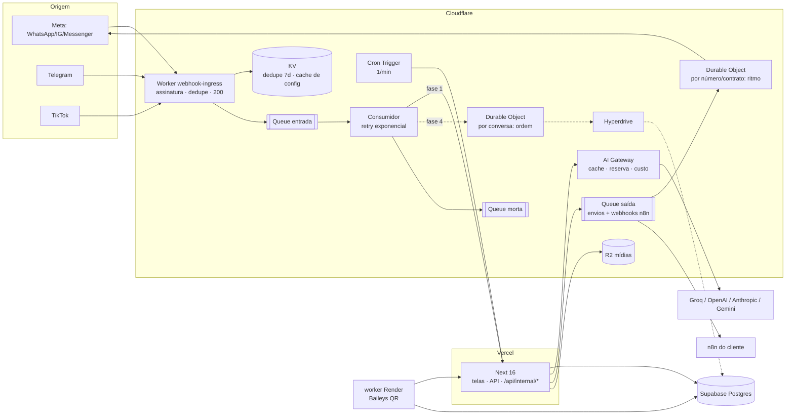

# Arquitetura escalável com Cloudflare — Eva Studio

Data: 2026-10-20 · Frente F7 do plano `docs/superpowers/plans/2026-10-20-builder-agentes-integracoes.md`
Status: **proposta para decisão do dono**. Primeira peça pronta e testada em
`cloudflare/webhook-ingress/` (não publicada; nada foi criado na Cloudflare).

---

## 1. Resumo para decidir

**Recomendação:** colocar a Cloudflare **na borda e na fila**, e deixar a
Vercel/Next como está para tela, API e regras de negócio. Em fases, cada uma
reversível:

1. **Entrada de webhooks no Worker** (pronta): Meta/Telegram/TikTok batem num
   Worker que valida, deduplica, enfileira e responde 200 em milissegundos; a
   fila entrega ao app com retry e fila morta. Hoje a Meta espera o motor de
   fluxo inteiro (banco + LLM + envio) rodar dentro do request — num pico, isso
   vira timeout, reentrega e resposta duplicada.
2. **Relógio pelo Cron Trigger** (complementa o pg_cron) e **AI Gateway** na
   frente das chamadas de LLM (cache, reserva entre provedores, custo por
   contrato) — encaixa na central de IA.
3. **Fila de saída** (envios da API oficial e webhooks para o n8n) com
   **Durable Object** por número (ritmo de 80 msg/s da Meta) e por conversa
   (ordem e uma resposta por vez).
4. Só se o volume pedir: **consumidor rodando o motor no próprio Worker** via
   **Hyperdrive** até o Postgres, e mídias no **R2**.

**Custo Cloudflare estimado** (detalhe na §7): 1 mil msgs/mês → US$ 0–5;
100 mil → US$ 5; 1 milhão → ~US$ 12 (só entrada) a ~US$ 20 (alvo completo).
O custo que pesa continua sendo Meta (conversas/modelos), Vercel e Supabase.

**O que fica fora:** o worker do Baileys (WhatsApp por QR) continua no Render —
precisa de uma conexão aberta 24h com o WhatsApp, coisa que Worker não faz
(§9).

**O que preciso do dono:** conta Cloudflare (plano Workers Paid, US$ 5/mês),
decidir se usa domínio próprio para os webhooks (ex. `hooks.<domínio>`), e
cadastrar os segredos (§11).

---

## 2. Como está hoje

```
Meta / Telegram / TikTok ──POST──▶ Vercel: /api/webhooks/{meta,telegram,tiktok}
                                      │  verifica assinatura
                                      │  advanceConversation()  (Postgres via Prisma)
                                      │  LLM (src/lib/server/llm.ts, direto no provedor)
                                      │  envia resposta (Graph API / Telegram / TikTok)
                                      ▼
                                   200 (só no fim de tudo)

pg_cron ─────────▶ /api/internal/scheduler (sequências, disparos, lotes, lixeira)
worker Render ───▶ Baileys (WhatsApp QR) + fila OutboundQueueItem (FOR UPDATE SKIP LOCKED)
                   + tickScheduler a cada 60 s (segundo relógio)
```

Pontos fracos para escala:

- **Processamento síncrono no webhook.** A Meta re-tenta por até 7 dias quando
  não recebe 200 a tempo; o webhook precisa responder rápido e processar
  assíncrono (skill `crm-whatsapp-channel`, "Regras de webhook"). Hoje um LLM
  lento atrasa o 200.
- **Sem amortecedor de pico.** Disparo em massa de 10 mil modelos gera ~30 mil
  webhooks de status (enviado/entregue/lido) em minutos; cada um é uma função
  da Vercel abrindo conexão no Postgres.
- **Dedupe só da Meta, no banco** (`isFirstDelivery` usando a tabela de rate
  limit). Telegram e TikTok não têm.
- **Corrida por conversa.** Duas mensagens do mesmo contato no mesmo segundo
  rodam o motor em paralelo.
- **LLM sem camada comum:** sem cache, sem reserva de provedor, sem custo por
  contrato num lugar só.

---

## 3. Arquitetura alvo



### 3.1 O que vai para cada peça

| Peça | Uso no Eva Studio | Por quê |
|---|---|---|
| **Workers** (borda) | Entrada de webhooks: valida HMAC da Meta / secret token do Telegram / token do TikTok, dedupe, enfileira, 200 em ms. Handshakes GET. | Roda perto da Meta, sem cold start relevante, sem conexão a banco. Isola o app de pico e de lixo (assinatura inválida morre na borda). |
| **Queues** | `entrada` (webhook → app) e, na fase 3, `saida` (envios pela API oficial e webhooks para o n8n). Retry com espera exponencial e **fila morta (DLQ)**. | Desacopla receber de processar; entrega pelo menos uma vez; 5.000 msg/s por fila; retenção até 14 dias. |
| **Durable Objects** | (a) **Um por conversa** (`agentId:canal:contato`): processa uma mensagem por vez, na ordem. (b) **Um por número/contrato**: balde de fichas no ritmo da Meta (80 msg/s por número; 20 em coexistência) e cota por contrato. | Único lugar da Cloudflare com estado forte e serializado. Resolve corrida e o erro 130429 (throughput) sem `Promise.all`. |
| **KV** | Dedupe com TTL (já na peça 1); cache de configuração lida a cada mensagem (conexão do número → agente, fluxo publicado) com invalidação ao salvar. | Leitura barata e global. Eventualmente consistente (~60 s) — serve para cache e dedupe de melhor esforço, **não** para contador. |
| **D1** | Não recomendado agora. | O dado mora no Postgres; um segundo banco relacional só traria sincronização. Fica como opção para log de entregas de webhook se o Postgres pesar. |
| **R2** | Mídias recebidas (fotos/áudios do WhatsApp, que expiram na Meta) e anexos de e-mail. | Sem custo de saída (egress); hoje o app baixa e guarda pelo `media-inbound`. Troca só o destino. |
| **AI Gateway** | Toda chamada de LLM do `src/lib/server/llm.ts` passa pelo gateway: **cache**, **retry e reserva** entre modelos/provedores, **limite de taxa**, **custo e tokens** por gateway/metadado; chaves guardadas no Secrets Store (BYOK). | É a camada que a "central de IA com várias chaves e reserva" precisa. Grátis nas funções principais. Troca é de URL base + cabeçalho; dá para ligar por contrato. |
| **Cron Triggers** | A cada minuto chama `/api/internal/scheduler` com `Authorization: Bearer` (a rota já aceita e já tem trava de rodada). | Terceiro relógio independente do banco e do Render; o pg_cron continua como reserva. |
| **Hyperdrive** | Só na fase 4: o consumidor/Durable Object fala direto com o Postgres do Supabase, com pool e cache de consultas. | Sem Hyperdrive, cada Worker abriria conexão TCP nova ao Postgres. Incluído no plano pago. |

### 3.2 O que fica na Vercel/Next

- Todas as telas, autenticação (Supabase), API v1 pública, builder, CRM.
- O **motor de fluxo** (`flow-engine.ts`) e as regras de negócio — nas fases
  1–3 a fila só muda **quando** ele roda, não **onde**.
- Rotas internas: `/api/internal/scheduler`, `/api/internal/media` e a nova
  `/api/internal/webhooks` (recebe da fila).
- As rotas `/api/webhooks/*` continuam no ar — são o caminho de volta.

---

## 4. Fluxo: mensagem de WhatsApp entrando → resposta saindo

Fase 1 (o que a peça pronta faz):

1. Cliente manda "oi". A Meta faz `POST https://<worker>/api/webhooks/meta`
   com `X-Hub-Signature-256`.
2. Worker lê o corpo **cru**, confere o HMAC com o App Secret (Web Crypto).
   Errado → 401, nada entra.
3. Monta a chave de dedupe pelos ids do lote (`messages[].id`,
   `statuses[].id + status`, `mid`, comentário…) e consulta o KV. Já visto →
   200 e para.
4. Enfileira `{origem, corpo cru, assinatura original}` na fila `entrada`.
   Só depois marca "visto" no KV (TTL 7 dias). Responde **200**.
5. Consumidor pega o lote (até 10), e para cada envelope faz
   `POST /api/internal/webhooks` com `x-eva-timestamp` +
   `x-eva-signature: v1=HMAC(segredo, "{ts}.{corpo}")`.
6. O app confere a assinatura (tolerância 5 min) e chama **o mesmo handler** de
   `/api/webhooks/meta`, que revalida o HMAC da Meta, roda
   `advanceConversation`, chama o LLM e envia a resposta pela Graph API.
7. 2xx → ack. 5xx/429/rede → retry em 30 s, 1 min, 2 min… até 1 h (20
   tentativas, ~15 h). 4xx → fila morta.
8. Os recibos (`sent`/`delivered`/`read`) da resposta voltam pelo mesmo
   caminho e atualizam a mensagem sem retroceder (já é assim no app).

Fase 3–4 (alvo): no passo 5 o consumidor manda o envelope para o **Durable
Object da conversa**, que processa uma por vez; a resposta vai para a fila
`saida`, cujo consumidor pede ficha ao **Durable Object do número** antes de
chamar a Graph API (80 msg/s; 130429 vira espera, nunca loop).

## 5. Fluxo: disparo em massa

1. Tela de disparo grava o disparo e o público no Postgres (como hoje).
2. O relógio (Cron Trigger → `/api/internal/scheduler` → `runDueBroadcasts`)
   em vez de enviar dentro da rodada, **publica lotes** na fila `saida`
   (`sendBatch` de até 100 por chamada), com `biz_opaque_callback_data` = id
   do disparo.
3. Consumidor da `saida` pede fichas ao DO do **número** (ritmo da Meta e
   limite do portfólio por 24h) e ao DO do **contrato** (cota/plano), envia o
   modelo, grava o `wamid`.
4. Erros: 131049 (teto de marketing) → **um** retry depois de 24 h, nunca loop;
   130429 → espera do balde; 131026/131047 → falha definitiva, sem retry;
   qualidade caindo (`phone_number_quality_update`) → pausa o disparo.
5. Os ~3 recibos por mensagem entram pela fila `entrada` — é aqui que a
   borda paga a conta: o pico de status não chega como pico na Vercel.

WhatsApp QR (Baileys) **não** entra nesse fluxo: disparo continua desligado ou
com freio duro nesse canal (regra da skill: canal não oficial).

## 6. Fluxo: webhook de saída (para n8n)

1. Evento de domínio (`deal.stage_changed`, `message.received`…) grava na
   **outbox** do Postgres na mesma transação (padrão da skill
   `crm-api-webhooks`).
2. Um publicador (rodada do relógio) lê a outbox e manda para a fila `saida`
   com `webhook-id` estável.
3. Consumidor assina no padrão **Standard Webhooks**
   (`webhook-id`, `webhook-timestamp`, `webhook-signature: v1,<base64>`),
   timeout 15 s, só 2xx é sucesso, 410 desativa, 429/5xx respeitam
   `Retry-After`; retry 5 s, 5 min, 30 min, 2 h, 5 h, 10 h, 10 h; depois fila
   morta + aviso ao admin.
4. Resultado de cada tentativa volta para `webhook_deliveries` (tela de log
   com **Reenviar**). DO por destino evita martelar o n8n do cliente.

---

## 7. Limites e custos

### 7.1 Limites que importam (Workers Paid)

| Recurso | Limite | Impacto |
|---|---|---|
| Worker | 10 milhões de req/mês e 30 milhões de ms de CPU inclusos; CPU até 5 min por request; 10.000 subrequests | Folga enorme para a borda |
| Workers Free | 100 mil req/dia, **10 ms de CPU** por invocação, 50 subrequests | Dá para testar; produção no pago |
| Queues | mensagem até **128 KB**; lote até 100; **5.000 msg/s por fila**; 250 consumidores simultâneos; até 100 retries; espera até 24 h; retenção 4 dias (padrão) a 14 | Corpo maior que ~120 KB a peça entrega direto ao app |
| Queues Free | 10 mil operações/dia, retenção fixa de 24 h | Pouco para produção |
| KV | propagação até ~60 s; evitar dezenas de escritas/s na mesma chave | Dedupe de melhor esforço (o app mantém o seu) |
| Durable Objects | ~1.000 req/s por objeto (limite suave); 10 GB por objeto (SQLite) | Um por conversa/número nunca chega perto |
| Cron Triggers | 250 por conta (5 no Free); CPU 30 s para intervalos < 1 h | 1 gatilho/min basta |
| Hyperdrive | consultas ilimitadas no pago (100 mil/dia no Free) | — |

### 7.2 Premissas da estimativa

- "Mensagens/mês" = entrada + saída, metade de cada.
- Cada mensagem enviada gera ~3 webhooks de status (enviado, entregue, lido),
  então **eventos de webhook ≈ 2 × mensagens**.
- Cada evento: 1 request no Worker, 1 KV get + 1 KV put, 3 operações de fila
  (escrita, leitura, remoção) e até 1 invocação de consumidor (pior caso, sem
  aproveitar lote).
- Alvo completo soma: fila de saída (3 operações por envio), 1 request de DO
  por envio, mídias em R2 (10% das mensagens, ~300 KB).
- Preços de tabela em US$ (out/2026), sem impostos.

### 7.3 Estimativa

| Volume | Eventos | Worker req | Fila (ops) | KV leit./escr. | Custo fase 1 | Custo alvo completo |
|---|---|---|---|---|---|---|
| **1 mil msgs/mês** | 2 mil | ~4 mil | ~6 mil | 2 mil / 2 mil | **US$ 0** no Free (cabe nos limites diários) ou **US$ 5** no pago (recomendado: retenção e sem teto diário) | US$ 5 |
| **100 mil msgs/mês** | 200 mil | ~400 mil | ~600 mil | 200 mil / 200 mil | **US$ 5** (tudo dentro do incluso) | **US$ 5** |
| **1 milhão msgs/mês** | 2 milhões | ~4 milhões | ~6 milhões → 5 M extras × US$ 0,40 = US$ 2 | 2 M / 2 M → 1 M escritas extras × US$ 5 = US$ 5 | **~US$ 12** | **~US$ 15–20** (saída +US$ 0,60; DO dentro do incluso; R2 ~30 GB novos/mês ≈ +US$ 0,45 acumulando) |

Otimização fácil quando chegar a 1 M: não deduplicar recibos de status na
borda (o app já aplica status sem retroceder, é idempotente) — corta ~75% das
escritas de KV, o maior item.

**Fora da Cloudflare (referência):** a fase 1 não reduz o número de funções da
Vercel (continua 1 por evento), mas tira o pico e o timeout. A redução vem na
fase 4 (consumidor processando direto via Hyperdrive) ou agrupando envelopes
por request. Supabase: o ganho é ter conexões no ritmo da fila, não do pico.

---

## 8. Riscos e cuidados

| Risco | Mitigação |
|---|---|
| Dedupe no KV não é atômico nem imediato entre regiões | App mantém `isFirstDelivery` (Meta). Telegram/TikTok: retry do consumidor após timeout pode duplicar resposta → fase 3 com DO por conversa resolve; até lá, timeout de 60 s. |
| Ordem não garantida pela Queue | Consumidor processa um por vez dentro do lote (ordem aproximada); ordem forte só com DO por conversa (fase 3). |
| Segredo divergente entre Worker e app | 401/403 vão para a fila morta (não somem); `/health` + `wrangler tail`; nada é descartado em silêncio. |
| App fora do ar | Fila segura até 4 dias (até 14 configurável); retry exponencial com variação para não acordar tudo junto. |
| Payload > 128 KB | Entrega direta ao app (síncrona) só nesse caso raro. |
| Mais uma conta/fornecedor | Tudo em `cloudflare/` com `wrangler.jsonc` versionado; segredos só por `wrangler secret`. |
| Dependência da Cloudflare para receber mensagens | Rotas antigas continuam no ar; voltar = trocar a URL de callback. |
| Prisma 7 dentro do Worker (fase 4) | Validar em prova de conceito (driver adapter `pg` + Hyperdrive) antes de mover o motor. |
| LGPD (mensagens passam pela Cloudflare) | Fila e KV guardam o corpo por dias; dedupe guarda só hash. Atualizar a lista de suboperadores. |

---

## 9. O worker do Baileys fica fora — por quê

O Baileys mantém **uma conexão WebSocket aberta 24 h** com os servidores do
WhatsApp, com chaves de sessão (Signal) em memória e reconexão própria.

- **Worker** vive o tempo de um request/evento; não segura conexão de saída
  depois que responde.
- **Durable Object** até abre WebSocket de saída, mas a hibernação só vale para
  conexões **de entrada** — uma conexão de saída mantém o objeto acordado e
  cobrando duração o tempo todo, e o Baileys depende de APIs do Node (crypto,
  sistema de arquivos para o auth-store) que o runtime não oferece por inteiro.
- O processo do Render já resolve isso de forma simples e barata.

**O que muda nele:**

- Fase 2: o Cron Trigger vira o relógio principal; o `tickScheduler` do worker
  pode continuar como reserva (a trava de rodada do scheduler já evita
  rodada dupla).
- Fase 3 (opcional): mensagens recebidas pelo Baileys podem entrar pela mesma
  fila `entrada` (assinadas com o mesmo segredo), ganhando retry e fila morta
  em vez de `fetch` direto para `/api/conversations/message`.
- A fila de envio dele (`OutboundQueueItem` com `FOR UPDATE SKIP LOCKED`)
  continua no Postgres — é o lugar certo para um consumidor que já está
  conectado ao banco.

---

## 10. Plano de migração (cada fase com volta)

| Fase | O que entra | Como liga | Como volta | Pronto quando |
|---|---|---|---|---|
| **0** | Conta, Workers Paid, KV, 2 filas, segredos | `wrangler` (README da peça) | Apagar recursos | `/health` responde |
| **1** | Entrada de webhooks (peça pronta) + rota `/api/internal/webhooks` | Trocar a URL de callback: primeiro um app Meta de teste, depois Telegram de um agente, depois produção | Reapontar a URL para o app (as rotas antigas nunca saíram) | 1 semana sem item na fila morta e p95 do 200 < 100 ms |
| **2** | Cron Trigger → scheduler; AI Gateway no `llm.ts` (atrás de configuração por contrato) | Novo Worker `cloudflare/relogio`; URL base do provedor por gateway | Desligar o gatilho (pg_cron e Render seguem); desligar o gateway por contrato | Batidas no `heartbeat` a cada minuto; custo por contrato visível |
| **3** | Fila de saída + DO por número/contrato; webhooks para n8n pela fila; DO por conversa na entrada | Flag por contrato: envio pela fila vs. direto | Flag volta para envio direto | Disparo de 10 mil sem 130429 e sem duplicata |
| **4** | Consumidor roda o motor no Worker via Hyperdrive; mídias no R2 | Por canal, atrás de flag | Consumidor volta a entregar em `/api/internal/webhooks` | Prova de conceito do Prisma 7 no Worker aprovada |

---

## 11. O que precisa do dono

1. **Conta Cloudflare** com **Workers Paid** (US$ 5/mês) — Queues com retenção
   de 4+ dias e sem teto diário.
2. **Domínio** (opcional, recomendado): um subdomínio para webhooks
   (ex. `hooks.<domínio>`) na Cloudflare. Sem ele, usa `*.workers.dev`.
3. **Segredos** (cadastrar com `wrangler secret put`, nunca em arquivo):
   `META_APP_SECRET`, `META_WEBHOOK_VERIFY_TOKEN`, `TELEGRAM_SECRET_TOKEN`
   (= `INTERNAL_API_SECRET` do app), `TIKTOK_WEBHOOK_TOKEN`
   (= `INTERNAL_API_SECRET`), `INGRESS_SIGNING_SECRET` (novo, também na Vercel).
4. **Vercel:** adicionar `INGRESS_SIGNING_SECRET` e publicar a versão com
   `/api/internal/webhooks`.
5. **Meta:** acesso ao App Dashboard para trocar a Callback URL (de preferência
   com um app de teste antes).

---

## 12. Fontes

Cloudflare (consultadas em 2026-10-20):

- Workers — preços: https://developers.cloudflare.com/workers/platform/pricing/
- Workers — limites: https://developers.cloudflare.com/workers/platform/limits/
- Queues — preços: https://developers.cloudflare.com/queues/platform/pricing/
- Queues — limites: https://developers.cloudflare.com/queues/platform/limits/
- KV — consistência: https://developers.cloudflare.com/kv/concepts/how-kv-works/
- Durable Objects — limites: https://developers.cloudflare.com/durable-objects/platform/limits/
- Hyperdrive — preços: https://developers.cloudflare.com/hyperdrive/platform/pricing/
- AI Gateway — visão geral: https://developers.cloudflare.com/ai-gateway/
- AI Gateway — preços: https://developers.cloudflare.com/ai-gateway/reference/pricing/
- AI Gateway — chaves (BYOK): https://developers.cloudflare.com/ai-gateway/configuration/bring-your-own-keys/
- Testes com Vitest: https://developers.cloudflare.com/workers/testing/vitest-integration/write-your-first-test/

Meta / produto:

- Webhooks e validação de payload: https://developers.facebook.com/docs/graph-api/webhooks/getting-started
- Regras de webhook do WhatsApp (resposta rápida, reentrega por 7 dias,
  idempotência por `messages[].id`/`statuses[].id+status`, 80 msg/s,
  erros 131049/130429): skill interna `crm-whatsapp-channel` (out/2026).
- Assinatura, retry e outbox de webhooks de saída: skill interna
  `crm-api-webhooks` (Standard Webhooks).
